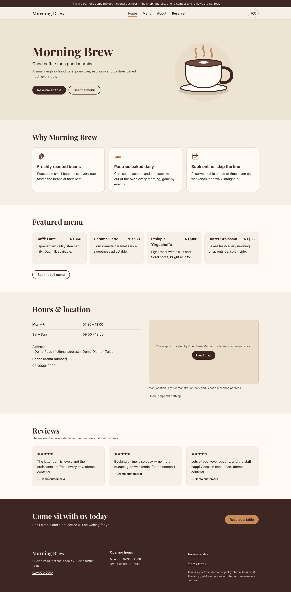
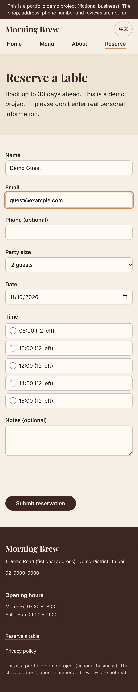
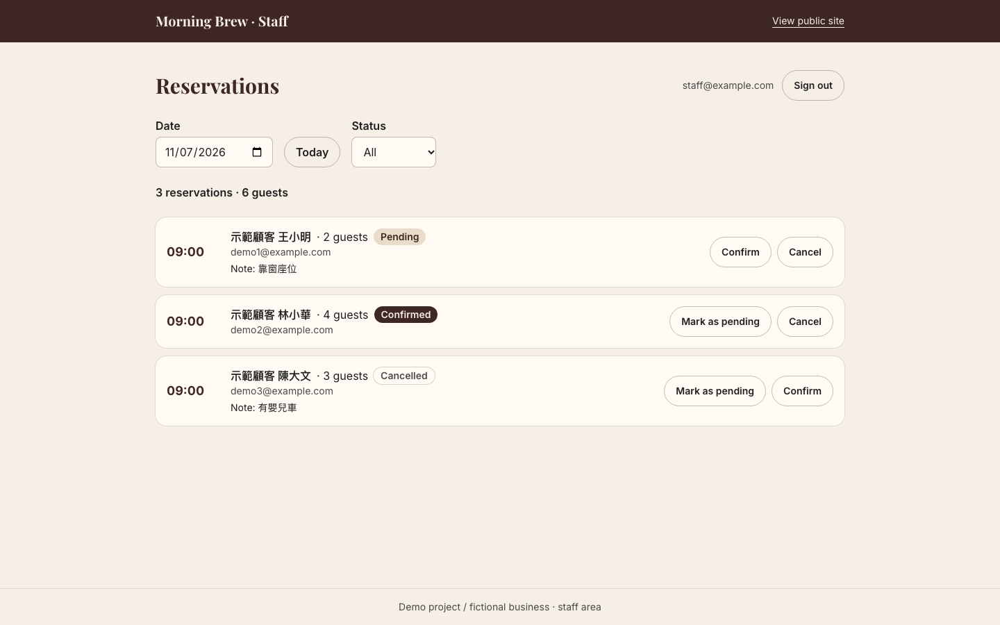
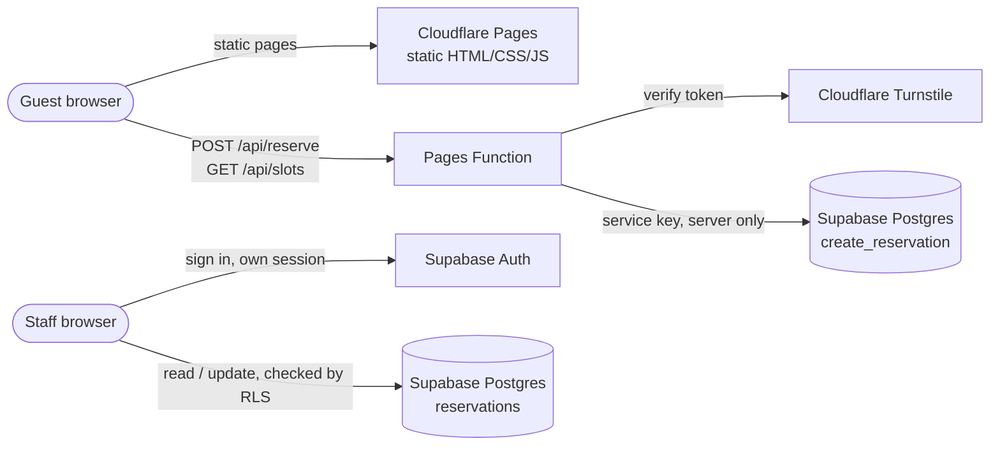
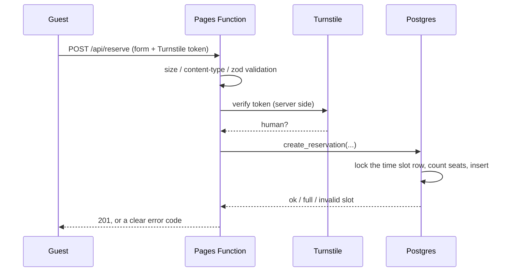
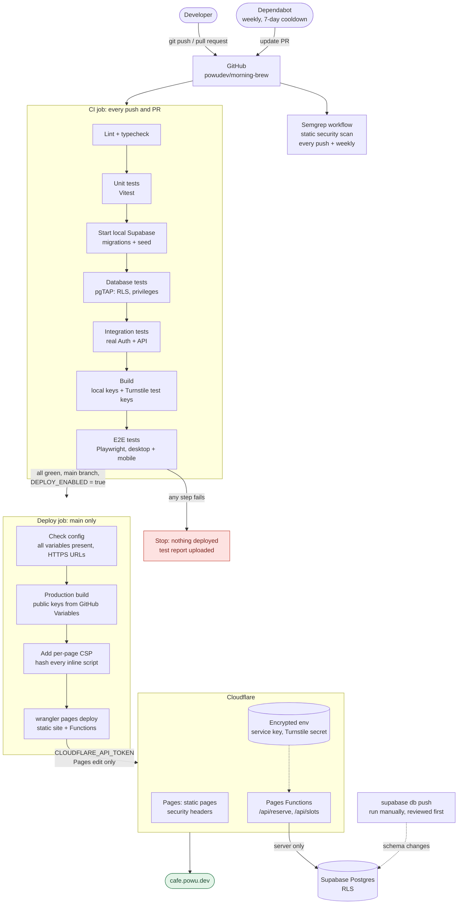

# Morning Brew — café website with online reservations and a staff dashboard

[](https://github.com/powudev/morning-brew/actions/workflows/ci.yml)
[](https://github.com/powudev/morning-brew/actions/workflows/semgrep.yml)

> **Demo project / fictional business.** Morning Brew is not a real café. The address, phone number,
> reviews and reservations are all made up. Please don't enter real personal information on the demo site.

A bilingual (English / Traditional Chinese) small-business website where guests can book a table
online and staff manage reservations from a private dashboard. It is built to show how a small site
can be **fast, accessible, and secure by design**, with every change tested and deployed
automatically.

- **Live demo:** [cafe.powu.dev](https://cafe.powu.dev)
- **Video walkthrough (Loom):** _coming soon_

## Why this matters if your app was built with AI

Lovable, Bolt and similar tools usually generate the same kind of stack: a frontend plus Supabase.
They get you a working demo fast, but they often skip the parts you can't see:
- database rules (Row Level Security, RLS) that are missing or too open,
- secret keys that end up in the browser,
- no tests, so every change can break something.

This project shows what those parts look like when they're done properly. I can review or fix the
same things in your app.

| Home (desktop) | Reservation form (mobile) | Staff dashboard |
|---|---|---|
|  |  |  |

More screenshots are in [`docs/screenshots/`](docs/screenshots/).

## Features

**For guests**
- Home, menu, about, privacy and reservation pages, in English (default) and Traditional Chinese (`/zh-tw/`)
- Online booking: pick a date, see the remaining seats for each time slot, and book
- Bot protection with Cloudflare Turnstile (usually invisible to real people)
- Works well on phones and with keyboards and screen readers. Every page passes automated accessibility checks (axe-core, WCAG 2.1 AA rules)
- SEO: per-page metadata, `hreflang` for both languages, sitemap, robots.txt, and structured data (JSON-LD)

**For staff**
- Private sign-in (staff accounts only, public sign-up is disabled)
- Reservation list by date, with status filters and a daily summary
- Confirm, cancel, or reset a reservation to pending

## Tech stack

| Area | Choice |
|---|---|
| Frontend | Next.js 16 (App Router, static export), React 19, TypeScript, Tailwind CSS 4 |
| Backend | Cloudflare Pages Functions (reservation API), Supabase (Postgres, Auth, RLS) |
| Validation | zod (shared by the form and the API) |
| Testing | Vitest + Testing Library, pgTAP, Playwright + axe-core |
| CI/CD | GitHub Actions → Cloudflare Pages; Dependabot; Semgrep |
| Tooling | pnpm, ESLint, Supabase CLI, Wrangler |

## Architecture



- Public pages are plain static files served by Cloudflare's CDN, so they are fast and cheap to host.
- Guests never talk to the database directly. A booking goes through a small server function that
  checks the bot-protection token, validates the input, and then calls one database function.
- Staff use their own login. The database decides what each person may see or change.

### Booking flow



## Security design

This section is written for business owners, not just engineers. The website assumes that anyone on
the internet may try to misuse it, so every layer says "no" by default. In short:

- **Visitors can't touch the database.** The public site has no access to any data.
- **Bookings have one controlled door**, and the same seat can't be booked twice.
- **Staff access is enforced by the database itself**, and the master key stays on the server.

**1. Visitors can't read or change data directly.**
The public site has no permission to read any database table. Page content (menu, hours, reviews)
is built into the site, so even someone who copies the site's public key can read nothing with it.

**2. Bookings go through one controlled door.**
A small server function checks for bots (Cloudflare Turnstile) and validates every field before
the booking reaches the database. If an outside service is down, it refuses the booking instead of
letting unchecked requests through.

**3. No double-booking, even under heavy traffic.**
The database locks a time slot while it counts seats. In a test, 10 people book a slot with 4 seats
at the same moment: exactly 4 succeed.

**4. Staff see only what staff should see.**
Staff sign in with their own accounts, and public sign-up is turned off. The database rules (RLS)
in the database allows only staff accounts to view reservations, and they can change only the
booking status. Anyone else who signs in is signed out immediately and sees nothing.

**5. The powerful key stays on the server.**
The database master key lives only in Cloudflare's encrypted settings. It is never in the browser,
the code repository, or the build output.

**Privacy.** The site collects only what a booking needs (name, email, optional phone and note).
The map loads from OpenStreetMap only after the visitor clicks. The site itself adds no analytics
or tracking scripts.

<details>
<summary><strong>Technical details for engineers</strong></summary>

- **Request handling** (`server/reserve.ts`): content-type and body-size checks → zod validation →
  server-side Turnstile verification → `create_reservation()`. External failures return 503
  (fail closed); unexpected errors return 500 without internal details.
- **Overbooking**: `create_reservation()` takes `select … for update` on the slot row and checks
  capacity in the same transaction. The concurrency test (10 parallel bookings, capacity 4) was
  verified the other way too: with the lock removed, it catches the overbooking every time.
- **Privileges**: `anon` has no table privileges; `authenticated` has `select` and column-level
  `update (status)`; RLS policies use a `security definer` staff check. Tested with pgTAP and
  against real Auth + PostgREST as anonymous, non-staff and staff users.
- **Content Security Policy**: Next.js static export can't use nonces, so a post-build step hashes
  every inline script and writes a per-page CSP: `script-src 'self'` + those hashes + Turnstile,
  no `unsafe-inline` / `unsafe-eval`. `public/_headers` adds `frame-ancestors 'none'`, HSTS,
  `nosniff`, Referrer-Policy and Permissions-Policy; the staff area is `no-store` + `noindex`.
  The site runs on a `.dev` domain, which browsers only ever load over HTTPS (HSTS-preloaded TLD).
  Every Playwright test fails on any CSP violation.
- **Secrets**: the service-role key exists only in Cloudflare Pages environment variables; the
  repository has only [`.env.example`](.env.example) with variable names.
- **Supply chain**: Semgrep on every push and weekly; Dependabot weekly with a 7-day cooldown;
  all GitHub Actions pinned to commit SHAs.

</details>

## Testing

Three layers: unit, integration (database rules + real API), and end-to-end. Development is
test-first (TDD): each feature starts with a failing test. Security rules always have "must be
refused" tests, not just happy paths.

Counts as of November 2026:

| Layer | Tool | What it covers | Count |
|---|---|---|---|
| Unit / component | Vitest, Testing Library | validation rules, i18n, SEO, CSP builder, API handlers (external services mocked), form and dashboard behaviour | 172 |
| Integration: database | pgTAP (`supabase test db`) | schema, table privileges, RLS policies, booking and availability functions | 49 |
| Integration: API | Vitest + local Supabase | real Auth + REST API + RLS as anonymous / non-staff / staff | 10 |
| End-to-end | Playwright + axe-core | both languages, desktop and mobile: pages, booking success and failures (field errors, full slot, Turnstile rejection), staff sign-in and status changes, accessibility, security headers and CSP | 268 |

Some real problems the tests caught during development:
- a database function let a weekly time slot be booked on the wrong weekday (a `NULL` comparison bug), caught by pgTAP;
- English pages lost their fonts because a Chinese-font CSS variable didn't exist there, caught by a screenshot review and fixed after writing a failing E2E test;
- the validation library probed `eval` on every page load, which the CSP reports as a violation, so it was switched to its no-eval mode;
- after launch, the hosting provider silently injected an analytics script on the custom domain. The CSP blocked it (so no visitor was tracked), and it was then switched off at the source.

### Lighthouse

Measured on the live site (cafe.powu.dev) on 11 November 2026: home, menu, reservation and the
Chinese home page, each on mobile and desktop.

| Performance | Accessibility | Best Practices | SEO |
|---|---|---|---|
| 99–100 | 100 | 100 | 100 |

Largest Contentful Paint: about 0.5 s on desktop and 1.2 s on mobile. (The staff sign-in page is
not included: it is marked `noindex` on purpose.)

## CI/CD and deployment

Every change goes through the same automated path. Nothing reaches the live site unless every test
layer passes.



- **CI** runs on every push and pull request, including Dependabot's weekly update PRs.
- **Deploy** runs only on `main`, after CI is green. It uses a Cloudflare token that can only edit
  Pages, and the production secrets live in Cloudflare's encrypted settings, not in GitHub.
- **Database changes** are not applied automatically: `supabase db push` is run by hand after review,
  so a bad migration can't reach production just because tests passed.

## Local development

Requirements: Node 24, pnpm, Docker, [Supabase CLI](https://supabase.com/docs/guides/local-development).

```bash
pnpm install
supabase start                      # local Postgres + Auth, applies migrations and seed data
scripts/create-staff.sh you@example.com   # create a local staff account (asks for a password)
pnpm dev                            # http://localhost:3000 (pages only; the booking API needs wrangler)
```

Run the same checks as CI:

```bash
pnpm lint && pnpm typecheck
pnpm test                 # unit / component
supabase test db          # database (pgTAP)
pnpm test:integration     # real local Supabase
pnpm test:e2e             # builds, then runs Playwright against wrangler pages dev
pnpm screenshots          # regenerates docs/screenshots/
```

## Environment variables

See [`.env.example`](.env.example). Never commit real values.

| Name | Where | Public? |
|---|---|---|
| `NEXT_PUBLIC_SUPABASE_URL` | build + Pages Function | yes |
| `NEXT_PUBLIC_SUPABASE_ANON_KEY` | build (staff dashboard) | yes, safe because of RLS |
| `NEXT_PUBLIC_TURNSTILE_SITE_KEY` | build | yes |
| `SUPABASE_SERVICE_ROLE_KEY` | Cloudflare Pages env only | **no** |
| `TURNSTILE_SECRET_KEY` | Cloudflare Pages env only | **no** |

## Deployment

- Database: `supabase db push` applies the migrations in `supabase/migrations/`.
- Site: the CI `deploy` job builds the static site and runs `wrangler pages deploy` (static files plus `functions/`).
  It runs only on `main`, after all tests pass, and only once the repository variable `DEPLOY_ENABLED` is `true`.

## Project structure

```
app/            routes: (en) English, (zh)/zh-tw Chinese, (admin) staff area
components/     page content, form, dashboard
content/        site, menu and review data + UI strings for both languages
functions/api/  Cloudflare Pages Functions (thin entry points)
server/         API logic (testable, fetch injected)
lib/            shared logic: validation, i18n, SEO, CSP
supabase/       migrations, seed data, pgTAP tests
tests/          integration and Playwright E2E tests
public/_headers security headers
```

## Credits

Illustrations are original SVGs made for this project. Fonts are self-hosted (SIL Open Font License).
Map © OpenStreetMap contributors. Details in [`docs/credits.md`](docs/credits.md).

## About

Built by Po Wei Wu, a DevOps engineer. I help founders take AI-built apps to production:
deployment, security reviews, and CI/CD. GitHub: [@powudev](https://github.com/powudev)
